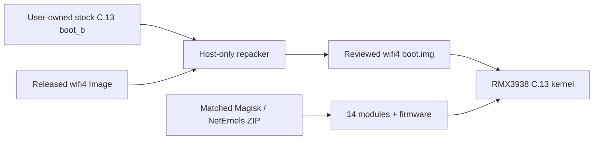

# Realme Note 60x USB Wi-Fi kernel

[English](README.md) | [Русский](README_RU.md)

[](#exact-compatibility)
[](#exact-compatibility)
[](#technical-basis)
[](LICENSE)
[](#validation-status)

Unofficial external USB Wi-Fi support for the **Realme Note 60x
(`RMX3938`)** running **`RMX3938export_15_C.13` / Android 15**.

The project combines a rebuilt Android common 5.15 kernel with a matched set
of signed loadable modules for selected Realtek, Qualcomm Atheros and MediaTek
USB Wi-Fi chipsets. The final `wifi4-cfi-runtime` variant retains Full LTO,
Control Flow Integrity and compatibility with the target firmware's vendor
module ABI.

> [!IMPORTANT]
> This release targets exactly `RMX3938export_15_C.13`. The kernel `Image` and
> module ZIP are a cryptographically matched pair. Other devices, firmware
> builds, kernels and separately rebuilt modules are not supported.

## What users receive

The release provides the files needed to reproduce the same kernel variant on
a computer without redistributing Realme's stock boot image:

- the exact compiled kernel binary, `Image`;
- `realme-note60x-wifi4-magisk.zip` for Magisk-compatible module managers,
  including NetErnels;
- a strictly validating host-only boot repacker;
- complete corresponding Android common and external driver sources;
- the final kernel configuration, ABI data, patches and build provenance;
- signed `.ko` modules and firmware for MT7612U and AR9271;
- SHA-256 manifests for every downloadable release asset.

The repository does **not** contain a Realme ramdisk or stock `boot.img`. A
user supplies their own exact C.13 `boot_b` image. The repacker verifies the
entire input, inserts the released kernel, recreates the reviewed AVB metadata,
checks the complete output and stops. It contains no ADB, fastboot or flashing
commands.



## Supported driver families

| Chipset family | Primary module | Bands | Monitor mode / injection path |
| --- | --- | --- | --- |
| RTL8812AU / RTL8814AU | `88XXau.ko` | 2.4 / 5 GHz | implemented by the aircrack-ng driver |
| RTL8188EUS | `8188eu.ko` | 2.4 GHz | implemented by the aircrack-ng driver |
| RTL8812BU / RTL8822BU | `88x2bu.ko` | 2.4 / 5 GHz | implemented by the imported driver |
| AR9271 | `ath9k_htc.ko` | 2.4 GHz | native mac80211 path |
| MT7612U | `mt76x2u.ko` | 2.4 / 5 GHz | native mac80211 path |

A feature being present in the driver does not guarantee identical behavior
for every adapter revision. USB IDs, firmware, OTG stability, available power,
the antenna, regulatory settings and the userspace application all affect the
result.

## Exact compatibility

| Property | Required value |
| --- | --- |
| Device | Realme Note 60x |
| Model code | `RMX3938` |
| Firmware build | `RMX3938export_15_C.13` |
| Android | 15 |
| Kernel base | Android common 5.15 |
| Kernel release | `5.15.178-android13-8-00006-g0c6055fd2d8b-ab13363910` |
| Boot format | header v4, 64 MiB partition, empty boot ramdisk |
| Bootloader | unlocked, so it can accept the prepared AVB `NONE` image |

The repacker also requires the full SHA-256 of the user's stock C.13 `boot_b`
to match the reviewed source image. A similar-looking boot image from another
build is rejected before an output file is produced.

## Validation status

The host-side verification covered the following:

- Android Clang `r450784e` build with Full LTO;
- ABI comparison against the saved stock vendor module set;
- imports/CRC, vermagic, BTF/CFI and signatures for 17 module artifacts;
- dependency ordering for the 14 modules shipped in the companion ZIP;
- internal `payload.sha256` coverage for every `.ko` and firmware payload;
- callback type analysis after the external Realtek CFI fixes;
- AVB footer validation, an official `avbtool verify_image` pass and a
  corruption rejection test;
- confirmation that the module ZIP contains no partition images;
- exact byte-for-byte reproduction of the reviewed boot image by the public
  host-only repacker;
- successful kernel boot, module visibility in NetErnels and external Wi-Fi
  operation on the target RMX3938, including monitor mode and frame injection.

Not every adapter family and hardware revision has been radio-tested. Reports
for specific adapters are welcome through the provided GitHub issue form.

## Release files

| File | Purpose |
| --- | --- |
| `Image` | exact wifi4 ARM64 kernel binary |
| `realme-note60x-wifi4-magisk.zip` | matched signed modules and firmware |
| `realme-note60x-wifi4-driver-sources-and-config.tar.gz` | external driver sources, final configuration and build recipes |
| `android-common-0c6055….tar.gz` | complete pinned Android common kernel source |
| `SHA256SUMS.txt` | checksums for all release assets |

Primary checksums:

```text
c7a1a7e7a6d9784d00e7d8f0c18f5ee072b5f006e8696162d2405ac515d305db  Image
610c83d49709af3890951995c9b016c2c1f050a14f81c44a0d0cefcf6debf2f5  realme-note60x-wifi4-magisk.zip
7c67c4b876c7710b2248dca9f7bbe9942087c44365baf7be1cc39cdd83c700a7  expected repacked boot.img
```

See [`SHA256SUMS.txt`](SHA256SUMS.txt) for the complete asset list.

## Quick host-side preparation

1. Download `Image`, the companion module ZIP and `SHA256SUMS.txt` from the
   [release page](https://github.com/Ivanich69/realme-note60x-wifi-drivers/releases).
2. Verify the SHA-256 of every downloaded file.
3. Obtain your own **exact stock C.13 `boot_b`** image.
4. Run the host-only repacker shown below.
5. Keep the released `Image` and module ZIP together as one versioned pair.

### Windows PowerShell

```powershell
python .\tools\repack_own_boot.py `
  .\boot_b-stock-C13.img `
  .\Image `
  .\out\realme-note60x-wifi4-boot.img
```

### Linux / WSL

```bash
./tools/repack-own-boot.sh \
  ./boot_b-stock-C13.img \
  ./Image \
  ./out/realme-note60x-wifi4-boot.img
```

Expected result:

```text
Created and verified: .../realme-note60x-wifi4-boot.img
SHA256: 7c67c4b876c7710b2248dca9f7bbe9942087c44365baf7be1cc39cdd83c700a7
Host-only operation complete. No device was accessed.
```

The script refuses a wrong stock boot, a modified kernel, an unexpected boot
header or any output that differs from the reviewed image.

For the full explanation of every check, module and limitation, read the
**[detailed English guide](docs/EN.md)** or the
**[подробное руководство на русском](docs/RU.md)**.

> [!WARNING]
> This repository deliberately stops after producing and validating files. It
> does not automate installation on a phone. Preserve your own stock image and
> establish a recovery path you understand before performing any separate
> device-side operation. An OTA update normally invalidates this kernel/module
> pair.

## Technical basis

- Android common kernel:
  `0c6055fd2d8b95ec88db7bfd79bfd1e471592215`, tag
  `android13-5.15-2025-03_r2`;
- Android Clang:
  `9f759dee5cdc5f85d076c642a192f6a9232f7058`, directory
  `clang-r450784e`;
- rtl8812au:
  `734485506a30d6237c2deaad666a19f8ca5379f2`;
- rtl8188eus:
  `af3bf004458f76b7aec33e9ba552cd382ed1f5c3`;
- rtl8812bu:
  `d31ffa827bb95b8a436c2a469b5163b634ac4333`.

Machine-readable provenance is available in
[`SOURCE_MANIFEST.json`](SOURCE_MANIFEST.json) and [`provenance/`](provenance/).

## Repository layout

```text
abi/              Module.symvers and the public module-signing certificate
build-recipes/    historical build and artifact-validation recipes
config/           final kernel configuration and ABI symbol list
docs/             detailed English and Russian documentation
drivers/          exact imported and modified Realtek source trees
licenses/         firmware and regulatory database licenses
module-template/  scripts and metadata used by the companion ZIP
patches/          final compatibility and callback-CFI changes
provenance/       source pins, manifests and hashes
tools/            host-only boot repacker
```

See **[BUILDING.md](BUILDING.md)** for the complete build/source
correspondence notes or **[BUILDING_RU.md](BUILDING_RU.md)** in Russian.

## Module loading design

The companion package keeps automatic module loading disabled by default. Its
manual action performs the following checks before loading anything:

1. the device model is `RMX3938`;
2. the firmware display ID is `RMX3938export_15_C.13`;
3. the wifi4 kernel marker is present in `/proc/version`;
4. the running kernel configuration has the expected SHA-256;
5. the stock `cfg80211` module is already active;
6. every `.ko` and firmware payload matches the ZIP's checksum manifest;
7. modules are loaded once, in the validated dependency order.

The package uses the stock `cfg80211` implementation. Native mac80211,
ath9k_htc and mt76 components are loaded only for the Atheros and MediaTek
paths.

## Known limitations

- Android's standard Wi-Fi framework normally continues to treat the built-in
  `wlan0` as its primary interface. The presence of `wlan1` does not mean the
  stock Settings application can manage the external adapter.
- The modules are specific to this `Image`, configuration, ABI and signing
  certificate.
- An OTA or manual firmware update requires a new compatibility review.
- High-power adapters may need a powered USB hub instead of a passive OTG
  adapter.
- Applications may report “no driver” when they use a hard-coded recognition
  table even though the kernel interface exists and operates.
- WPS discovery and ordinary Android scanning are userspace features and do
  not by themselves prove that monitor mode or injection is unavailable.

## Troubleshooting overview

| Symptom | Likely area to inspect |
| --- | --- |
| Module manager rejects the package | device/build/kernel/config guard mismatch |
| Modules load but no interface appears | unsupported USB ID, missing firmware or USB power |
| Adapter repeatedly disconnects | OTG cable, hub, power draw or USB signal integrity |
| `wlan1` exists but an app says “no driver” | application-side driver detection |
| Stock Android scan ignores `wlan1` | Android framework is bound to the internal interface |
| Monitor mode works but injection is unstable | adapter revision, channel, regulatory domain or driver behavior |
| Modules stop loading after an OTA | kernel ABI/configuration changed |

## Contributing and security reports

Use the adapter compatibility issue form for hardware reports. Include the
adapter model and revision, USB VID:PID, available power and separate results
for interface creation, ordinary scanning, monitor mode and injection. Never
publish IMEI values, device serial numbers, MAC addresses, credentials,
private captures, keys or partition dumps.

Development rules are in [`CONTRIBUTING.md`](CONTRIBUTING.md). Integrity,
privacy and security reporting guidance is in [`SECURITY.md`](SECURITY.md).

## Responsible use

Monitor mode and frame injection are dual-use capabilities. Use them only on
networks and equipment you own or are explicitly authorized to test. This
project is intended for driver development, interoperability testing and
authorized security research.

The project is not affiliated with or endorsed by Realme, Google, MediaTek,
Qualcomm, Kali Linux or the imported driver maintainers.

## Licenses

Kernel and driver code is distributed under GPL-2.0 terms. Firmware remains
under its separate licenses. Read [`THIRD_PARTY.md`](THIRD_PARTY.md) and the
files in [`licenses/`](licenses/) before redistributing binaries.
