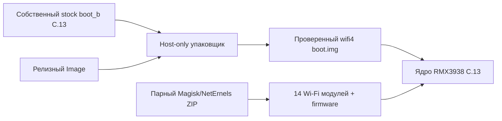

# Realme Note 60x: USB Wi-Fi kernel

[](#совместимость)
[](#совместимость)
[](#техническая-основа)
[](LICENSE)
[](#что-проверено)

Неофициальное ядро и комплект загружаемых модулей для внешних USB Wi-Fi
адаптеров на **Realme Note 60x (`RMX3938`)** с прошивкой
**`RMX3938export_15_C.13` / Android 15**.

Проект добавляет драйверы для популярных адаптеров Realtek, Qualcomm Atheros
и MediaTek, сохраняя Full LTO, CFI и совместимость со штатным набором
модулей целевой прошивки.

> [!IMPORTANT]
> Этот выпуск предназначен только для `RMX3938export_15_C.13`. Ядро и модули
> образуют одну связанную пару. Использование на другой модели, сборке
> прошивки или с другим ядром не поддерживается.

## Что получит пользователь

Релиз содержит всё необходимое, чтобы на компьютере получить тот же вариант
ядра и установить совместимый комплект Wi-Fi модулей:

- точный бинарник ядра `Image`;
- модуль `realme-note60x-wifi4-magisk.zip` для Magisk/NetErnels;
- проверенный host-only упаковщик пользовательского штатного `boot`;
- полные исходники ядра и внешних драйверов;
- итоговую конфигурацию, ABI-файлы, патчи, историю проверок и хеши;
- firmware для MT7612U и AR9271.

Штатный `boot.img` Realme не распространяется. Пользователь предоставляет
собственный образ от точной сборки C.13, а упаковщик воспроизводит проверенный
`boot.img` и останавливается. В нём нет ADB, fastboot или команд прошивки.



## Поддерживаемые семейства

| Чипсет / семейство | Основной модуль | Диапазоны | Monitor mode / injection |
| --- | --- | --- | --- |
| RTL8812AU / RTL8814AU | `88XXau.ko` | 2,4 / 5 ГГц | реализованы драйвером aircrack-ng |
| RTL8188EUS | `8188eu.ko` | 2,4 ГГц | реализованы драйвером aircrack-ng |
| RTL8812BU / RTL8822BU | `88x2bu.ko` | 2,4 / 5 ГГц | реализованы импортированным драйвером |
| AR9271 | `ath9k_htc.ko` | 2,4 ГГц | штатный стек mac80211 |
| MT7612U | `mt76x2u.ko` | 2,4 / 5 ГГц | штатный стек mac80211 |

Наличие функции в драйвере не гарантирует одинаковое поведение всех ревизий
адаптера. На результат также влияют USB OTG, питание, firmware, антенна,
регуляторный домен и используемая программа.

## Совместимость

| Параметр | Требуемое значение |
| --- | --- |
| Устройство | Realme Note 60x |
| Код модели | `RMX3938` |
| Прошивка | `RMX3938export_15_C.13` |
| Android | 15 |
| Базовое ядро | Android common 5.15 |
| Kernel release | `5.15.178-android13-8-00006-g0c6055fd2d8b-ab13363910` |
| Boot header | v4, раздел 64 МиБ, пустой boot ramdisk |
| Загрузчик | разблокированный для подготовленного образа AVB `NONE` |

Упаковщик дополнительно требует точное совпадение SHA-256 собственного
штатного `boot_b` C.13. С похожим, но другим образом он завершится ошибкой до
создания результата.

## Что проверено

- ядро собрано Android Clang `r450784e` с Full LTO;
- ABI сопоставлен со штатными vendor-модулями;
- 17 собранных модулей проверены по imports/CRC, vermagic, BTF/CFI и подписи;
- 14 модулей в ZIP расположены в проверенном порядке зависимостей;
- все payload-файлы ZIP защищены внутренним `payload.sha256`;
- callback-типы внешних Realtek-драйверов проверены после CFI-исправлений;
- AVB-footer и содержимое итогового boot проверены независимыми проверками;
- host-only упаковщик воспроизводит ранее проверенный boot байт-в-байт;
- на целевом RMX3938 подтверждены загрузка ядра, появление модулей в
  NetErnels и работа внешнего Wi-Fi адаптера, включая monitor/injection;
- конкретные модели адаптеров для всех пяти семейств отдельно не проверялись.

## Быстрый путь

1. Откройте [Releases](../../releases) и скачайте `Image`, модульный ZIP,
   `SHA256SUMS.txt` и при необходимости архивы исходников.
2. Проверьте SHA-256 скачанных файлов.
3. Возьмите **собственный точный штатный `boot_b` от C.13**.
4. На ПК запустите `tools/repack_own_boot.py`; он создаст и проверит готовый
   образ без обращения к телефону.
5. Используйте модульный ZIP только вместе с этим `Image`.

Подробная последовательность, команды для Windows/Linux и объяснение каждого
файла находятся в **[русском руководстве](docs/RU.md)**.

> [!WARNING]
> Репозиторий не автоматизирует установку на телефон. Сохраните собственный
> штатный образ и заранее подготовьте понятный вам способ возврата. Обновление
> прошивки обычно меняет ядро и нарушает совместимость этой пары.

## Файлы релиза

| Файл | Назначение |
| --- | --- |
| `Image` | точный бинарник ядра wifi4 |
| `realme-note60x-wifi4-magisk.zip` | подписанные модули и firmware |
| `realme-note60x-wifi4-driver-sources-and-config.tar.gz` | внешние драйверы, конфигурация и рецепты |
| `android-common-….tar.gz` | полный исходный код базового ядра |
| `SHA256SUMS.txt` | контрольные суммы релиза |

Основные контрольные суммы:

```text
c7a1a7e7a6d9784d00e7d8f0c18f5ee072b5f006e8696162d2405ac515d305db  Image
610c83d49709af3890951995c9b016c2c1f050a14f81c44a0d0cefcf6debf2f5  realme-note60x-wifi4-magisk.zip
7c67c4b876c7710b2248dca9f7bbe9942087c44365baf7be1cc39cdd83c700a7  ожидаемый результат упаковки boot.img
```

Полный список находится в [`SHA256SUMS.txt`](SHA256SUMS.txt).

## Техническая основа

- Android common kernel:
  `0c6055fd2d8b95ec88db7bfd79bfd1e471592215`
  (`android13-5.15-2025-03_r2`);
- Android Clang:
  `9f759dee5cdc5f85d076c642a192f6a9232f7058`, каталог `clang-r450784e`;
- RTL8812AU:
  `734485506a30d6237c2deaad666a19f8ca5379f2`;
- RTL8188EUS:
  `af3bf004458f76b7aec33e9ba552cd382ed1f5c3`;
- RTL8812BU:
  `d31ffa827bb95b8a436c2a469b5163b634ac4333`.

Точные сведения машинного формата находятся в
[`SOURCE_MANIFEST.json`](SOURCE_MANIFEST.json) и каталоге
[`provenance/`](provenance/).

## Структура репозитория

```text
abi/              Module.symvers и публичный сертификат подписи модулей
build-recipes/    рецепты сборки и проверки артефактов
config/           итоговая конфигурация ядра и ABI symbol list
docs/             подробная пользовательская документация
drivers/          точные импортированные деревья Realtek
licenses/         лицензии firmware и regulatory database
module-template/  сценарии и метаданные модульного ZIP
patches/          итоговые compatibility/CFI изменения
provenance/       пины исходников, манифесты и хеши
tools/            host-only упаковщик пользовательского boot
```

Сведения о воспроизводимости сборки: **[BUILDING.md](BUILDING.md)**.

## Ограничения

- Системный Android Wi-Fi framework обычно продолжает считать встроенный
  `wlan0` основным интерфейсом. Наличие `wlan1` не означает, что штатные
  настройки Android смогут управлять внешним адаптером.
- Модули связаны с конкретным `Image`, конфигурацией и ключом подписи.
- После OTA или ручного обновления C.13 совместимость нужно проверять заново.
- Некоторые адаптеры требуют больше питания, чем телефон стабильно отдаёт
  через обычный OTG-переходник.
- Доступность monitor/injection в конкретном приложении зависит и от того,
  как приложение обнаруживает интерфейсы и драйверы.

## Ответственное использование

Monitor mode и frame injection являются технологиями двойного назначения.
Используйте их только на своих сетях и устройствах либо при явном разрешении
владельца. Проект предназначен для разработки драйверов, проверки
совместимости и разрешённого исследования безопасности.

Проект не связан с Realme, Google, MediaTek, Qualcomm, Kali Linux и авторами
импортированных драйверов.

## Обратная связь

Для отчёта о конкретном адаптере используйте готовую форму GitHub Issues.
Она подскажет, какие сведения полезны: аппаратная ревизия, USB VID:PID,
результаты обычного сканирования, monitor mode и injection. Правила для
изменений исходников описаны в [`CONTRIBUTING.md`](CONTRIBUTING.md), а порядок
сообщения о проблемах безопасности — в [`SECURITY.md`](SECURITY.md).

## Лицензии

Код ядра и драйверов распространяется на условиях GPL-2.0. Firmware остаётся
под собственными лицензиями. Перед распространением бинарников прочитайте
[`THIRD_PARTY.md`](THIRD_PARTY.md) и файлы из [`licenses/`](licenses/).

