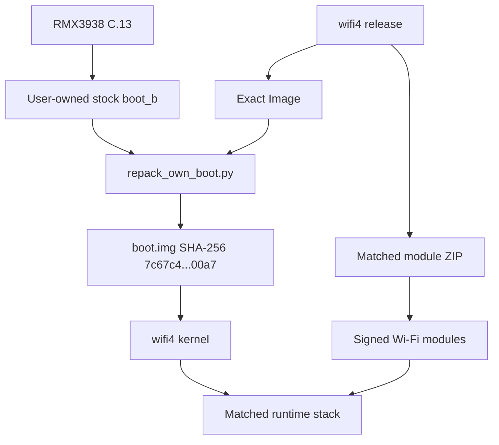

# Detailed Realme Note 60x wifi4 guide

[English](EN.md) | [Русский](RU.md)

This guide documents the public `wifi4-cfi-runtime` release for the Realme
Note 60x. It explains the release files, exact compatibility requirements,
host-side verification, deterministic boot repacking, module structure,
known limitations and source correspondence.

## 1. Project purpose

The stock Realme Note 60x kernel does not provide a ready-to-use collection of
drivers for external USB Wi-Fi adapters commonly used for network diagnostics.
This project supplies two tightly coupled components:

1. A kernel `Image` built with the required configuration, ABI and module
   signing certificate.
2. A wifi4 companion package containing signed `.ko` modules, firmware,
   dependency order and guarded loading logic.

The two components form one release unit. Mixing the kernel with modules from
another build can produce signature rejection, unresolved symbols, CFI faults
or unstable runtime behavior. The package therefore validates the running
device, firmware, kernel marker and configuration before loading its payload.

## 2. Exact compatibility requirements

All of the following must match:

| Check | Required value |
| --- | --- |
| Product | Realme Note 60x |
| Model | `RMX3938` |
| Firmware display ID | `RMX3938export_15_C.13` |
| Android | 15 |
| Released kernel | `5.15.178-android13-8-00006-g0c6055fd2d8b-ab13363910` |
| Boot partition size | 67,108,864 bytes |
| Boot format | Android boot image header v4 |
| Boot ramdisk | empty |
| Bootloader state | unlocked for the prepared AVB `NONE` image |

A different Realme UI release is a different target even when the model name
and visible Android version remain the same. Firmware updates may change the
vendor module ABI, kernel configuration, boot metadata or expected signing
certificate.

## 3. Release asset reference

### `Image`

The exact ARM64 kernel binary used by the release:

```text
c7a1a7e7a6d9784d00e7d8f0c18f5ee072b5f006e8696162d2405ac515d305db
```

It is already tied to the configuration and public module-signing certificate
stored under `config/` and `abi/`.

### `realme-note60x-wifi4-magisk.zip`

The companion package for Magisk-compatible module managers, including
NetErnels. It contains:

- 14 loadable kernel modules;
- AR9271 and MT7612U firmware;
- `load-order.txt` with the validated dependency order;
- `payload.sha256` covering every `.ko` and firmware file;
- guards for the model, firmware, kernel marker and configuration;
- a manual action that loads the driver stack.

Automatic module loading is disabled by default. This design limits the
impact of a problematic external driver during an ordinary Android boot.

### Complete source archives

`android-common-0c6055fd2d8b95ec88db7bfd79bfd1e471592215.tar.gz` contains the
complete base Android common kernel source.

`realme-note60x-wifi4-driver-sources-and-config.tar.gz` contains the exact
external driver trees, final configuration, ABI input, patches and historical
build recipes.

Together with this Git repository, the archives provide the corresponding
source for the published GPL binaries.

### `SHA256SUMS.txt`

This file lists the checksum of every downloadable release asset. Verify it
before using the files to detect an incomplete download or unexpected change.

## 4. Result architecture



The repacker does not extract or publish personal data. It validates the full
stock boot checksum and uses the required 4096-byte Android boot header to
reproduce the reviewed output.

## 5. Verifying downloads

### Windows PowerShell

Run these commands in the download directory:

```powershell
Get-FileHash -Algorithm SHA256 .\Image
Get-FileHash -Algorithm SHA256 .\realme-note60x-wifi4-magisk.zip
Get-FileHash -Algorithm SHA256 .\android-common-*.tar.gz
Get-FileHash -Algorithm SHA256 .\realme-note60x-wifi4-driver-sources-and-config.tar.gz
```

Compare the results with `SHA256SUMS.txt`. PowerShell usually displays hashes
in uppercase; letter case does not change the value.

### Linux or WSL

```bash
sha256sum -c SHA256SUMS.txt
```

Every downloaded file should report `OK`.

## 6. Reproducing the reviewed boot image on a computer

### Requirements

- Python 3.9 or newer;
- this repository or its source archive;
- the released `Image`;
- a user-owned exact C.13 stock `boot_b`;
- approximately 150 MiB of free temporary space.

The pinned `avbtool.py` is already included. Magiskboot is not required.

### Windows

```powershell
python .\tools\repack_own_boot.py `
  .\boot_b-stock-C13.img `
  .\Image `
  .\out\realme-note60x-wifi4-boot.img
```

### Linux or WSL

```bash
./tools/repack-own-boot.sh \
  ./boot_b-stock-C13.img \
  ./Image \
  ./out/realme-note60x-wifi4-boot.img
```

Successful output ends with:

```text
Created and verified: .../realme-note60x-wifi4-boot.img
SHA256: 7c67c4b876c7710b2248dca9f7bbe9942087c44365baf7be1cc39cdd83c700a7
Host-only operation complete. No device was accessed.
```

If the final checksum differs, the tool treats the operation as failed and
does not leave an output image.

### Repacker validation sequence

The tool verifies all of the following:

1. The stock boot size is exactly 64 MiB.
2. The complete stock boot SHA-256 matches the reviewed C.13 source.
3. The released `Image` SHA-256 matches wifi4.
4. The input begins with Android boot magic and uses header version 4.
5. The boot ramdisk size is zero.
6. No embedded GKI boot signature is present.
7. The released file contains the ARM64 `Image` magic.
8. The recreated AVB structure passes the bundled official `avbtool` check.
9. The output contains the exact released kernel bytes.
10. The complete 64 MiB output matches the reviewed SHA-256.

The script has no ADB, fastboot, network download, partition write or phone
access code.

## 7. Driver and dependency layout

The companion package uses this module order:

```text
88XXau.ko
8188eu.ko
88x2bu.ko
mac80211.ko
ath.ko
ath9k_hw.ko
ath9k_common.ko
ath9k_htc.ko
mt76.ko
mt76x02-lib.ko
mt76x2-common.ko
mt76-usb.ko
mt76x02-usb.ko
mt76x2u.ko
```

The stock `cfg80211` is preserved. The loader requires it to be active before
adding the external and native Wi-Fi modules in the validated order.

| Family | Driver | Firmware included | Notes |
| --- | --- | --- | --- |
| RTL8812AU / RTL8814AU | `88XXau` | no separate file | aircrack-ng driver tree |
| RTL8188EUS | `8188eu` | no separate file | similarly named adapters can use different chips |
| RTL8812BU / RTL8822BU | `88x2bu` | no separate file | the adapter revision's USB ID must be supported |
| AR9271 | `ath9k_htc` | `htc_9271-1.4.0.fw` | native mac80211 stack |
| MT7612U | `mt76x2u` | `mt7662u*.bin` | native mac80211 stack |

## 8. Monitor mode and frame injection

The Realtek driver trees include monitor and injection paths. AR9271 and
MT7612U use the kernel's native mac80211 stack. The target phone has confirmed
working monitor/injection behavior with an external adapter, but that result
does not automatically validate every chipset family or adapter revision.

Practical behavior depends on:

- the real chipset behind the product name;
- the USB VID:PID and hardware revision;
- channel and band support;
- firmware initialization;
- regulatory-domain restrictions;
- USB power and signal integrity;
- userspace tool support.

## 9. Why an adapter may not appear

| Symptom | Likely cause |
| --- | --- |
| Modules are visible but no interface is created | unsupported USB ID, missing firmware or unstable power |
| USB connect/disconnect repeats | OTG cable, current limit, hub or signal integrity |
| `wlan1` exists but an application says “no driver” | application uses a curated or hard-coded driver table |
| Android Settings does not scan through `wlan1` | framework remains attached to built-in `wlan0` |
| Monitor mode works but injection is inconsistent | adapter revision, channel, regulatory domain or driver behavior |
| Modules fail after a firmware update | kernel ABI, configuration or signing expectations changed |

## 10. What “the same kernel” means

There are two useful reproducibility levels.

### Exact released binary

The release provides the exact `Image`. Given the expected stock C.13 boot,
the repacker produces a boot image with the same full checksum as the reviewed
working artifact. This avoids differences caused by timestamps, build paths or
a regenerated signing key.

### Fresh build from corresponding source

The repository and source archives provide the source, configuration and
pinned compiler needed to rebuild the functionality. A fresh build may not be
byte-identical because generated data, timestamps and a new signing key affect
the binary. A new key requires rebuilding the kernel and all modules as one
new pair.

## 11. Building from source

The successful build used Linux/WSL, Android Clang `r450784e`, Full LTO, one
build job and one linker thread. The final Full LTO link has a large memory
peak; approximately 28.5 GiB of RAM and 16 GiB of swap were available.

Historical recipes live in `build-recipes/`. Some preserve the original
`/mnt/f/wifi_work` build path and should be parameterized for a different
workspace. See [BUILDING.md](../BUILDING.md) for source overlay, validation and
reproducibility details.

## 12. Safety and recovery preparation

Before performing any separate device-side action outside this repository,
keep the following:

- your own original C.13 stock boot image;
- its verified checksum;
- the exact firmware build identifier;
- a recovery route you understand and have prepared independently.

The prepared boot uses AVB algorithm `NONE`, so an unlocked bootloader is
required to accept it. Project tooling deliberately ends after host-side file
creation and verification.

## 13. Source publication and licenses

Kernel and driver source is published under GPL-2.0 terms. Wi-Fi firmware is a
separate work distributed under the notices preserved in `licenses/`. The
project excludes Realme's stock boot image, user partition data, NV data,
device identifiers and private signing keys.

When forking or redistributing the project, preserve:

- `LICENSE`;
- upstream copyright and license headers;
- `THIRD_PARTY.md`;
- firmware license notices;
- complete corresponding source for every GPL binary you distribute.

## 14. Responsible use

This project is for driver development, personal equipment diagnostics and
authorized wireless testing. Frame transmission and client-disconnection
tests must be limited to your own laboratory or an environment for which the
owner has given explicit permission.
