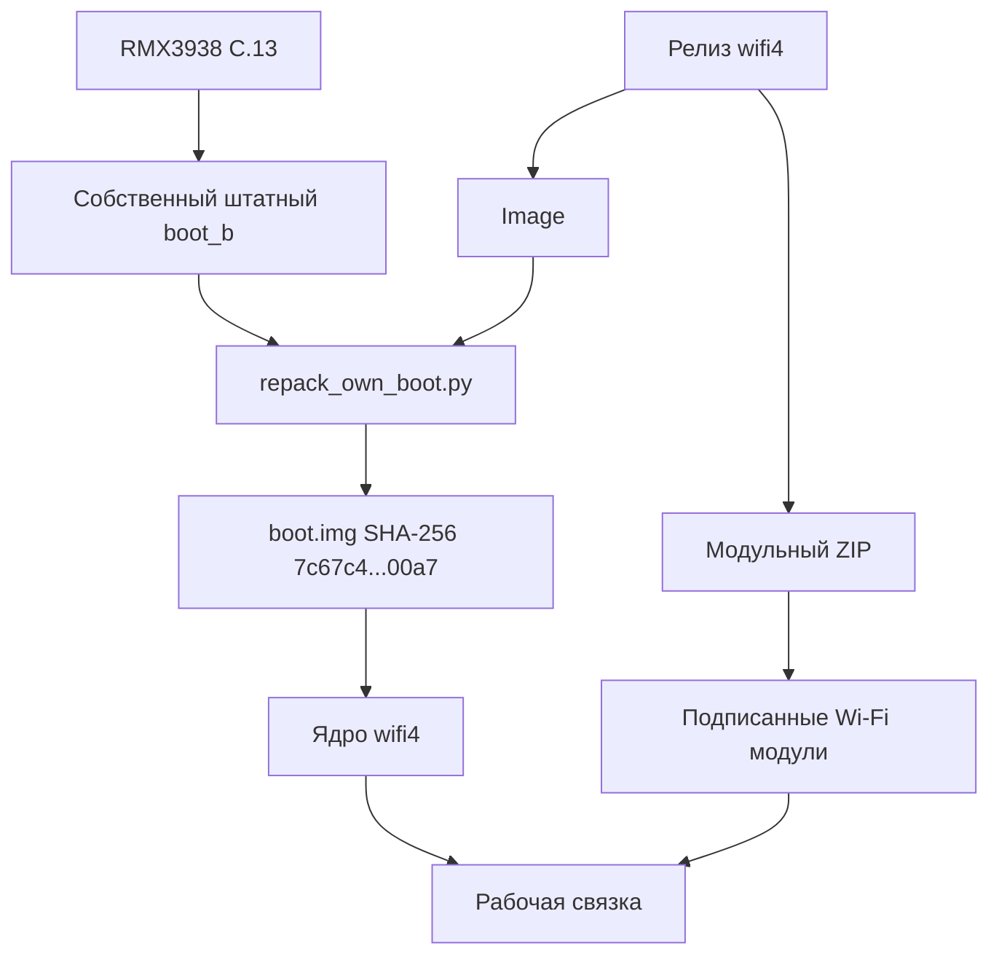

# Подробное руководство по Realme Note 60x wifi4

Это руководство описывает публичный выпуск ядра `wifi4-cfi-runtime` для
Realme Note 60x. Оно объясняет, какие файлы нужны, как проверить их на ПК и
как воспроизвести тот же `boot.img`, который был проверен на целевом телефоне.

## 1. Назначение проекта

Штатное ядро Realme Note 60x не предоставляет готовый набор драйверов для
внешних USB Wi-Fi адаптеров, которые часто применяются в диагностике сетей.
Проект решает эту задачу двумя связанными частями:

1. **Ядро `Image`** собрано с нужной конфигурацией, ABI и сертификатом
   модулей.
2. **Пакет wifi4** содержит подписанные `.ko` модули, firmware и безопасный
   сценарий их загрузки.

Эти части нельзя произвольно смешивать с другим ядром или другим выпуском
модулей. Встроенная проверка конфигурации и подписи специально предотвращает
загрузку несовместимого набора.

## 2. Точная совместимость

Перед подготовкой файлов должны одновременно выполняться все условия:

| Проверка | Значение |
| --- | --- |
| Модель | `RMX3938` |
| Название | Realme Note 60x |
| Сборка | `RMX3938export_15_C.13` |
| Android | 15 |
| Активное ядро выпуска | `5.15.178-android13-8-00006-g0c6055fd2d8b-ab13363910` |
| Размер раздела boot | 67 108 864 байта |
| Формат boot | Android boot image header v4 |
| Загрузчик | разблокирован |

Если номер сборки отличается хотя бы одним символом, этот выпуск использовать
не следует. Обновление Android может сохранить имя модели и версию ядра, но
изменить ABI, boot metadata или vendor-модули.

## 3. Что входит в релиз

### `Image`

Точный ARM64 бинарник ядра. Его SHA-256:

```text
c7a1a7e7a6d9784d00e7d8f0c18f5ee072b5f006e8696162d2405ac515d305db
```

Это ядро уже связано с конфигурацией и публичным сертификатом из каталогов
`config/` и `abi/`.

### `realme-note60x-wifi4-magisk.zip`

Комплект для Magisk-совместимого менеджера модулей, включая NetErnels. В нём
находятся:

- 14 загружаемых модулей;
- firmware для AR9271 и MT7612U;
- порядок зависимостей `load-order.txt`;
- контрольные суммы payload;
- проверки модели, прошивки, ядра и конфигурации;
- ручное действие для загрузки драйверов.

Автозагрузка намеренно не включена в опубликованном пакете. Это уменьшает риск
того, что проблема внешнего драйвера помешает обычному запуску Android.

### Архивы исходников

`android-common-0c6055fd2d8b95ec88db7bfd79bfd1e471592215.tar.gz` содержит
полное базовое дерево Android common kernel.

`realme-note60x-wifi4-driver-sources-and-config.tar.gz` содержит точные
внешние драйверы, итоговую конфигурацию, ABI-данные, патчи и рецепты.

Вместе с Git-репозиторием эти архивы дают соответствующие исходники для
опубликованных GPL-бинарников.

### `SHA256SUMS.txt`

Контрольные суммы всех файлов релиза. Проверка этого файла позволяет заметить
неполную загрузку, повреждение или подмену артефакта.

## 4. Схема результата



Упаковщик не извлекает и не публикует данные телефона. Он принимает локальный
штатный boot, проверяет его полный SHA-256 и использует только 4096-байтовый
заголовок, необходимый для точного воспроизведения результата.

## 5. Проверка скачанных файлов

### Windows PowerShell

В каталоге со скачанными файлами:

```powershell
Get-FileHash -Algorithm SHA256 .\Image
Get-FileHash -Algorithm SHA256 .\realme-note60x-wifi4-magisk.zip
Get-FileHash -Algorithm SHA256 .\android-common-*.tar.gz
Get-FileHash -Algorithm SHA256 .\realme-note60x-wifi4-driver-sources-and-config.tar.gz
```

Сравните полученные значения с `SHA256SUMS.txt`. Регистр букв в отображении
хеша значения не имеет.

### Linux / WSL

```bash
sha256sum -c SHA256SUMS.txt
```

Проверка должна завершиться статусом `OK` для каждого скачанного файла.

## 6. Получение идентичного boot.img на ПК

### Требования

- Python 3.9 или новее;
- этот репозиторий либо его архив;
- релизный `Image`;
- собственный штатный `boot_b` от точной прошивки C.13;
- не менее 150 МиБ свободного места.

`avbtool.py` уже включён в репозиторий и закреплён вместе с исходными
сведениями. Magiskboot для этого процесса не нужен.

### Windows

```powershell
python .\tools\repack_own_boot.py `
  .\boot_b-stock-C13.img `
  .\Image `
  .\out\realme-note60x-wifi4-boot.img
```

### Linux / WSL

```bash
./tools/repack-own-boot.sh \
  ./boot_b-stock-C13.img \
  ./Image \
  ./out/realme-note60x-wifi4-boot.img
```

При успехе последняя часть вывода выглядит так:

```text
Created and verified: .../realme-note60x-wifi4-boot.img
SHA256: 7c67c4b876c7710b2248dca9f7bbe9942087c44365baf7be1cc39cdd83c700a7
Host-only operation complete. No device was accessed.
```

Если итоговый SHA-256 отличается, инструмент считает упаковку неуспешной и не
оставляет выходной образ.

### Что именно проверяет упаковщик

1. Размер stock boot равен 64 МиБ.
2. Полный SHA-256 stock boot соответствует C.13.
3. SHA-256 `Image` соответствует релизу wifi4.
4. Вход имеет Android boot magic и header v4.
5. Размер ramdisk равен нулю.
6. В заголовке нет встроенной GKI boot signature.
7. ARM64 magic присутствует в `Image`.
8. После упаковки официальный `avbtool verify_image` принимает AVB-структуру.
9. В выходном образе находится точный релизный `Image`.
10. Полный результат совпадает с проверенным SHA-256 `7c67c4…00a7`.

Инструмент не содержит ADB, fastboot, сетевой загрузки, прошивки или обращения
к физическому устройству.

## 7. Драйверы и зависимости

Порядок загрузки в пакете:

```text
88XXau.ko
8188eu.ko
88x2bu.ko
mac80211.ko
ath.ko
ath9k_hw.ko
ath9k_common.ko
ath9k_htc.ko
mt76.ko
mt76x02-lib.ko
mt76x2-common.ko
mt76-usb.ko
mt76x02-usb.ko
mt76x2u.ko
```

Штатный `cfg80211` не заменяется. Загрузчик пакета требует, чтобы он уже был
активен, а затем добавляет внешние модули в заранее проверенном порядке.

| Семейство | Драйвер | Firmware в пакете | Примечание |
| --- | --- | --- | --- |
| RTL8812AU / RTL8814AU | `88XXau` | не требуется отдельно | aircrack-ng ветка |
| RTL8188EUS | `8188eu` | не требуется отдельно | подходит не ко всем устройствам с похожим названием |
| RTL8812BU / RTL8822BU | `88x2bu` | не требуется отдельно | USB ID конкретной ревизии должен поддерживаться |
| AR9271 | `ath9k_htc` | `htc_9271-1.4.0.fw` | нативный mac80211 драйвер |
| MT7612U | `mt76x2u` | `mt7662u*.bin` | нативный mac80211 драйвер |

## 8. Почему модуль может не увидеть адаптер

| Симптом | Вероятная причина |
| --- | --- |
| Модуль виден, интерфейса нет | неизвестный USB ID, firmware или нестабильное питание |
| Адаптер циклически отключается | OTG-кабель, ток питания или USB-ошибки |
| `wlan1` существует, приложение пишет «нет драйвера» | приложение использует собственную таблицу распознавания |
| Сканирование в Android не показывает сети `wlan1` | Android framework управляет встроенным `wlan0` |
| Monitor mode есть, injection нестабилен | ревизия адаптера, канал, регдомен или ограничения драйвера |
| После обновления прошивки модули не загружаются | изменилась ABI/конфигурация ядра |

## 9. Что означает «то же ядро»

Есть два разных уровня воспроизводимости:

### Тот же готовый бинарник

Релизный `Image` уже является точным бинарником. Если входной stock boot имеет
ожидаемый SHA-256, упаковщик создаёт boot с точным известным хешем. Это самый
надёжный способ получить тот же результат без различий от времени сборки или
нового ключа подписи модулей.

### Новая сборка из исходников

Репозиторий и два архива содержат соответствующие исходники, конфигурацию и
закреплённый toolchain. Новая сборка может функционально совпадать, но её байты
могут отличаться из-за временных меток, окружения и заново созданного ключа
подписи. Тогда необходимо вместе пересобрать ядро и все его модули.

## 10. Сборка из исходников

Сборка выполнялась под Linux/WSL с Android Clang `r450784e`, Full LTO, одним
build job и одним linker thread. Full LTO имеет высокий пик потребления памяти;
исходный успешный запуск имел около 28,5 ГиБ доступной RAM и 16 ГиБ swap.

Исторические рецепты находятся в `build-recipes/`. Часть из них сохраняет
исходный путь `/mnt/f/wifi_work`; перед новой сборкой путь следует заменить на
собственный build root. Подробности приведены в [BUILDING.md](../BUILDING.md).

## 11. Безопасность и возврат

Перед любыми действиями вне этого репозитория сохраните:

- собственный исходный `boot_b` C.13;
- контрольную сумму этого файла;
- точную версию прошивки;
- понятный вам независимый способ возврата к штатному состоянию.

Подготовленный boot использует AVB algorithm `NONE`; для его принятия требуется
разблокированный загрузчик. Репозиторий намеренно заканчивает работу на
создании и проверке файлов и не выполняет операции с разделами телефона.

## 12. Публикация и лицензии

Исходный код ядра и драйверов распространяется по GPL-2.0. Бинарные firmware
имеют отдельные разрешения на распространение, сохранённые в `licenses/`.
Штатный образ Realme, пользовательские дампы, NV-разделы, серийные номера и
приватные ключи в проект не входят.

При форке или повторной публикации сохраняйте:

- файл `LICENSE`;
- авторские заголовки импортированных драйверов;
- `THIRD_PARTY.md`;
- лицензии firmware;
- полные соответствующие исходники для публикуемых GPL-бинарников.

## 13. Разрешённое применение

Проект создан для разработки драйверов, диагностики собственного оборудования
и авторизованного тестирования беспроводных сетей. Передача кадров и отключение
клиентов допустимы только в собственной лаборатории или при явном разрешении
владельца сети.
